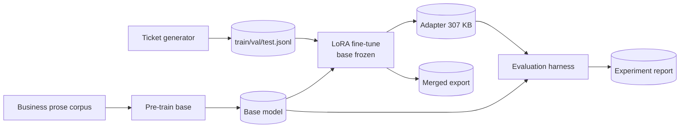

# Fine-Tuned Open-Source LLM with LoRA — End-to-End Pipeline

> An enterprise-style LoRA fine-tuning workflow that actually runs: a small
> transformer is pre-trained on generic business prose, then specialised for
> support-ticket triage with **LoRA implemented from scratch** — frozen base
> weights, low-rank adapters, adapter save/load, weight merging — and proven
> with a base-vs-tuned evaluation harness. CPU-only, end-to-end in ~2 minutes.

## The problem

Enterprise teams rarely need a bigger model; they need *their* model — one
that answers in the house format, with the house taxonomy, every time.
Full fine-tuning is expensive to train, store, and govern: every task gets
a full copy of the weights. **LoRA** (Hu et al., 2021) solves the
operational problem: freeze the base model, train a tiny low-rank update
per task, ship kilobytes-to-megabytes instead of gigabytes, and merge
only when you want a standalone model.

This project demonstrates that workflow honestly, at a scale where every
step can be inspected: the base model scores **0%** on the task; the
LoRA-tuned model scores **~98–100%** — and the only weights that changed
are the adapters.

## Results (held-out test split, n = 96, greedy decoding)

| Metric | Base model | LoRA-tuned | Delta |
|--------|-----------:|-----------:|------:|
| Format compliance | 0.00% | **100.00%** | +100.00% |
| Category accuracy | 0.00% | **97.92%** | +97.92% |
| Priority accuracy | 0.00% | **100.00%** | +100.00% |
| Action token F1 | 0.00% | **93.34%** | +93.34% |
| Exact response match | 0.00% | 32.29% | +32.29% |

Fine-tuning changed **77,568 of 548,736 parameters (14.1%)** — 12,288 in
LoRA adapters (rank 8, α = 16, on attention Q/V) plus the LM head as a
module-to-save. The adapter checkpoint is **307 KB** vs a 2.2 MB full
model. Full evidence: [`reports/experiment_report.md`](reports/experiment_report.md),
[`reports/metrics.json`](reports/metrics.json),
[`reports/training_log.csv`](reports/training_log.csv),
[`reports/loss_curve.svg`](reports/loss_curve.svg).

## Approach

1. **Synthetic instruction dataset** — enterprise support/ops tickets
   generated from symptom templates × applications with rule-based
   `Category / Priority / Action` labels; stratified train/val/test
   splits where held-out combinations are genuinely unseen
   ([data card](data/dataset/DATA_CARD.md)).
2. **Base pre-training** — a from-scratch decoder-only transformer
   (~0.55M params) trained as a plain LM on generic business prose. It
   learns the domain language, never the task format.
3. **LoRA from scratch** — `W = W₀ + (α/r)·(A@B)ᵀ`, `B` zero-initialised
   so an untrained adapter is exactly the identity; base weights frozen
   (and *proven* frozen by tests, not just by intention).
4. **Fine-tuning** — loss masked to response tokens; batches shifted for
   next-token prediction.
5. **Evaluation harness** — greedy generation, strict format parsing,
   five metrics, base vs tuned; the pipeline also asserts that the
   **merged model** and a **reloaded adapter** reproduce the tuned
   metrics exactly.
6. **Artifacts** — base checkpoint, adapter checkpoint, merged export,
   and an inference demo that puts base and tuned side by side.

## Architecture



Details: [`docs/architecture.md`](docs/architecture.md) ·
Model card: [`docs/model-card.md`](docs/model-card.md)

## Quickstart

```bash
# Install (CPU-only PyTorch)
pip install -r requirements.txt
pip install -e .

# Run the whole pipeline: dataset -> pre-train -> LoRA -> evaluate -> report
python scripts/train.py            # ~2 minutes on CPU

# Or step by step
python scripts/build_dataset.py    # writes data/dataset/*.jsonl + data card
python scripts/evaluate.py         # re-score base vs tuned from artifacts

# Try it: base vs LoRA-tuned, side by side
python examples/inference_demo.py
python examples/inference_demo.py --ticket "VPN drops every few minutes in CRM Portal"

# Tests
pytest -q                          # 27 tests
```

Docker:

```bash
docker build -t lora-finetuned-llm .
docker run --rm lora-finetuned-llm            # runs the full pipeline
```

## Repository layout

```
src/lora_llm/
  data.py        synthetic dataset generator + data card
  tokenizer.py   word-level tokenizer
  model.py       small decoder-only transformer
  lora.py        LoRA from scratch: inject / train / save / load / merge
  train.py       pre-training + LoRA fine-tuning loops
  evaluate.py    generation, format parser, metrics, report helpers
scripts/         build_dataset.py · train.py · evaluate.py
examples/        inference_demo.py (base vs tuned)
tests/           LoRA math, frozen-base, merge, alignment, data, eval
data/dataset/    generated JSONL splits + DATA_CARD.md
reports/         experiment report, metrics.json, training log, loss curve
docs/            architecture.md · model-card.md · github-actions-ci.yml
artifacts/       base / adapter / merged checkpoints (generated, gitignored)
```

## Testing

27 pytest tests cover the parts that silently break in real LoRA work:

- **LoRA math** — adapter shapes `(in, r)` / `(r, out)`, scaling `α/r`,
  ΔW orientation, zero-init identity (untrained adapter == base model).
- **Merge correctness** — merged weights equal `W₀ + ΔW` and merged
  outputs match adapter outputs to float tolerance.
- **Frozen-base guarantees** — frozen parameters receive no gradient and
  do not move during training; trainable counts match the LoRA formula.
- **Save/load round-trip** — a fresh base + reloaded adapter reproduces
  the tuned model exactly.
- **Batch alignment regression** — targets are labels shifted by one
  (the classic off-by-one that yields great teacher-forced loss and
  garbage generations — this bug was caught and fixed during development,
  and the test stays as a guard).
- Dataset determinism/splits, tokenizer round-trip, parser strictness.

## Limitations

- Toy scale by design: a 0.55M-parameter model on template data proves
  the *workflow*, not production capability. Labels are rule-based by
  construction; real tickets are ambiguous and multi-intent.
- Exact-match (32%) is the honest headline for verbatim runbook text;
  most remaining errors are entity substitutions inside an otherwise
  correct format.
- On out-of-distribution phrasings the tuned model can be confidently
  wrong while perfectly formatted — format compliance ≠ correctness.
- English only; no bias/safety evaluation; not for real triage.

## Roadmap

- Swap the toy base for a small open-weights HF model (same LoRA module
  interface), rank/target sweep with automatic report comparison.
- BPE tokenizer; packing and longer contexts; NEFTune-style noise option.
- Multi-task adapters (triage + summarisation) with adapter routing.
- Quantised base (INT8) + LoRA (QLoRA-style) variant and a serving
  benchmark of merged vs adapter inference latency.

## License

MIT — see [`LICENSE`](LICENSE). All code and data in this repository are
original and synthetic.
