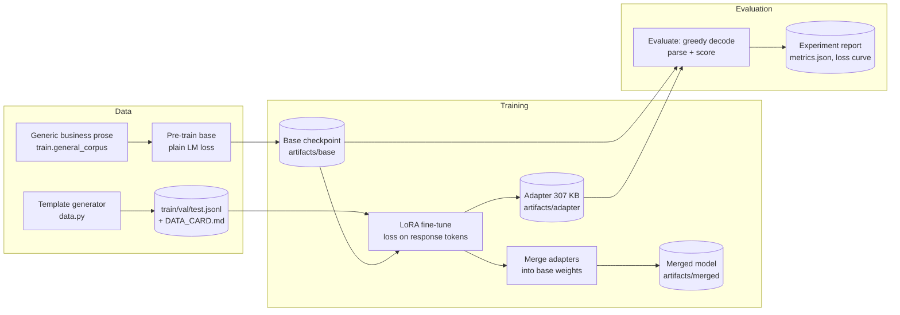

# Architecture

## Overview

The pipeline reproduces, at toy scale, the workflow an enterprise AI team
uses to specialise a foundation model for a structured task:

1. a **base model** that knows the domain language but not the task;
2. a **LoRA fine-tune** that teaches the task while the base stays frozen;
3. an **evaluation harness** that proves the delta on held-out data;
4. **adapter artifacts** (kilobytes) plus a **merged export** for serving.

## Components

### `lora_llm.data`
Template-based generator for enterprise support/ops tickets. Sixteen
symptom templates (each with a rule-based category, priority and runbook
action) are combined with eight applications, departments and error
codes, plus surface variation (openers/closers). Splits are stratified
and seeded; held-out splits contain symptom×application combinations
never trained on, so the evaluation measures compositional
generalisation.

### `lora_llm.tokenizer`
Word-level tokenizer (regex split, newlines preserved as tokens) with
`<pad>/<bos>/<eos>/<unk>` specials. Small and transparent — appropriate
for a 510-token synthetic vocabulary.

### `lora_llm.model`
Decoder-only transformer (d_model 128, 3 layers, 4 heads, ~0.55M
parameters), pre-norm blocks, separate Q/K/V/O projections (the modules
LoRA targets in production models), untied LM head.

### `lora_llm.lora`
LoRA from scratch (Hu et al., 2021):

- `LoRALinear` wraps an `nn.Linear`, keeps its weight frozen, and adds
  `ΔW = (α/r)·(A@B)ᵀ` with `A ~ Gaussian`, `B = 0` — so an untrained
  adapter is exactly the identity.
- `inject_lora` swaps targeted layers (`q_proj`, `v_proj`) in-place.
- `mark_only_lora_trainable` freezes the base and unfreezes the adapters
  plus `modules_to_save` (the LM head, PEFT-style) — 77.6K trainable
  parameters out of 548.7K (14.1%).
- `merge_lora` folds `ΔW` into the base weights and swaps plain
  `nn.Linear` layers back in, producing a standard model for serving.
- `save_adapter`/`load_adapter` persist only adapter tensors + the
  modules-to-save state + a JSON config.

### `lora_llm.train`
Two phases. Pre-training: plain next-token LM on generic business prose
(never the task format). Fine-tuning: next-token loss **masked to
response tokens**, batches shifted by one for next-token prediction (see
`tests/test_train.py` — the regression test for the classic off-by-one
that makes teacher-forced loss look great while generation fails).

### `lora_llm.evaluate`
Greedy generation per test ticket, a strict parser for the
`Category/Priority/Action` format, and metrics: format compliance,
category accuracy, priority accuracy, action token F1, exact match.
The pipeline asserts that the merged model and a reloaded adapter
reproduce the tuned metrics exactly.

## Design decisions & trade-offs

| Decision | Rationale |
|----------|-----------|
| Tiny model, synthetic data | The deliverable is the *workflow* — it must run end-to-end on CPU in minutes and be fully reproducible. |
| LoRA on Q/V only | Matches the original paper's most effective targets; keeps adapter math easy to audit. |
| LM head as module-to-save | Format-marker tokens are rare in prose pre-training; PEFT uses the same mechanism for the same reason. |
| Word-level tokenizer | Transparent for a small closed vocabulary; a production system would use BPE. |
| Greedy decoding in eval | Deterministic metrics; sampling would add noise, not insight, at this scale. |

## Scaling this to a real model

The same code paths map onto production practice: swap `TinyTransformer`
for a Hugging Face causal LM, keep the LoRA module (or PEFT's equivalent),
raise rank to 16–64, target all linear layers, train on real (governed)
instruction data with a held-out set, and gate promotion on the same
five metrics plus human review of sampled generations.
